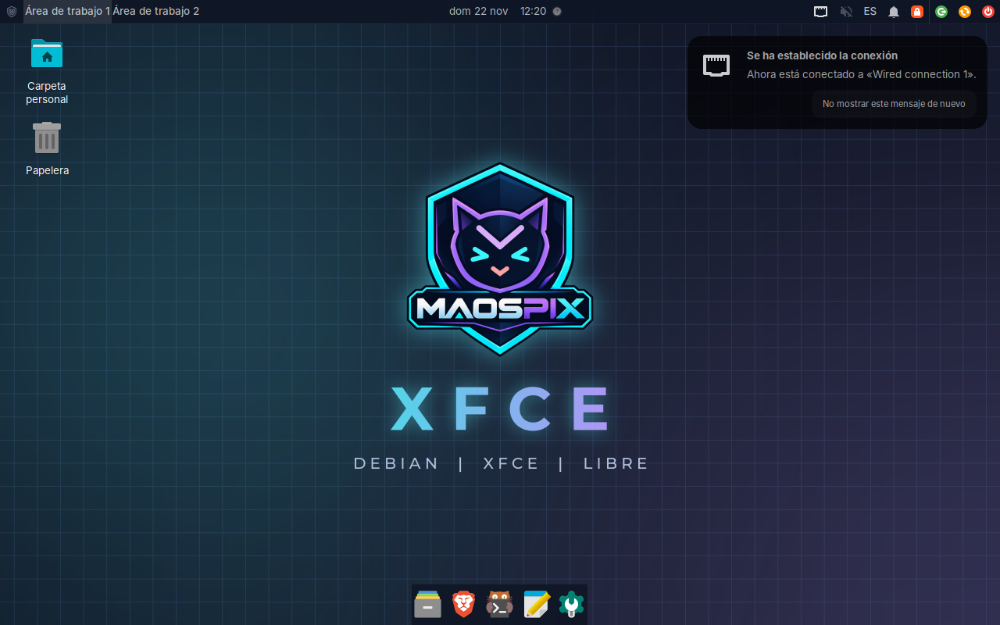
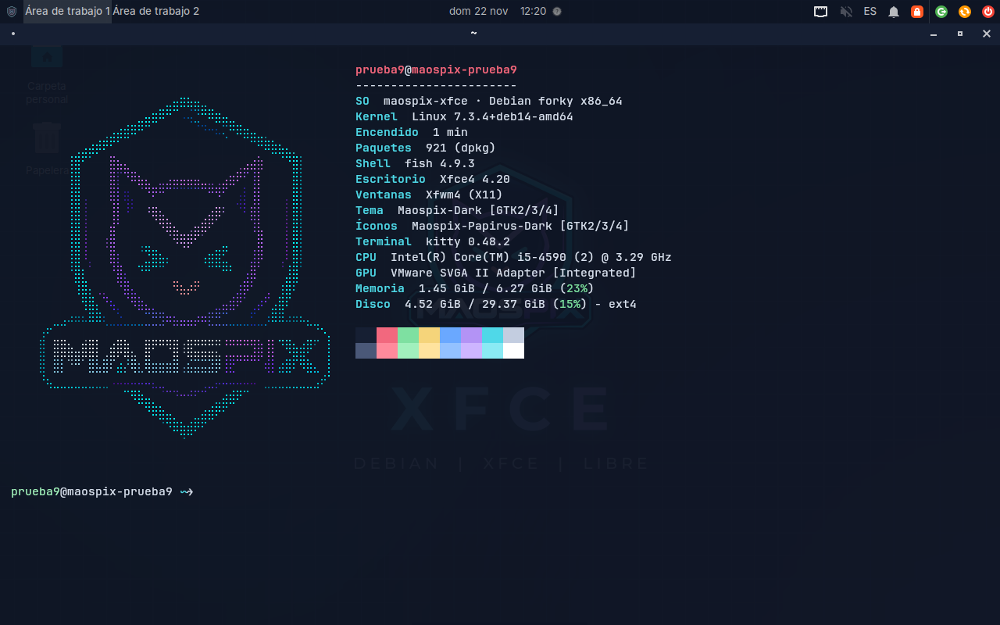
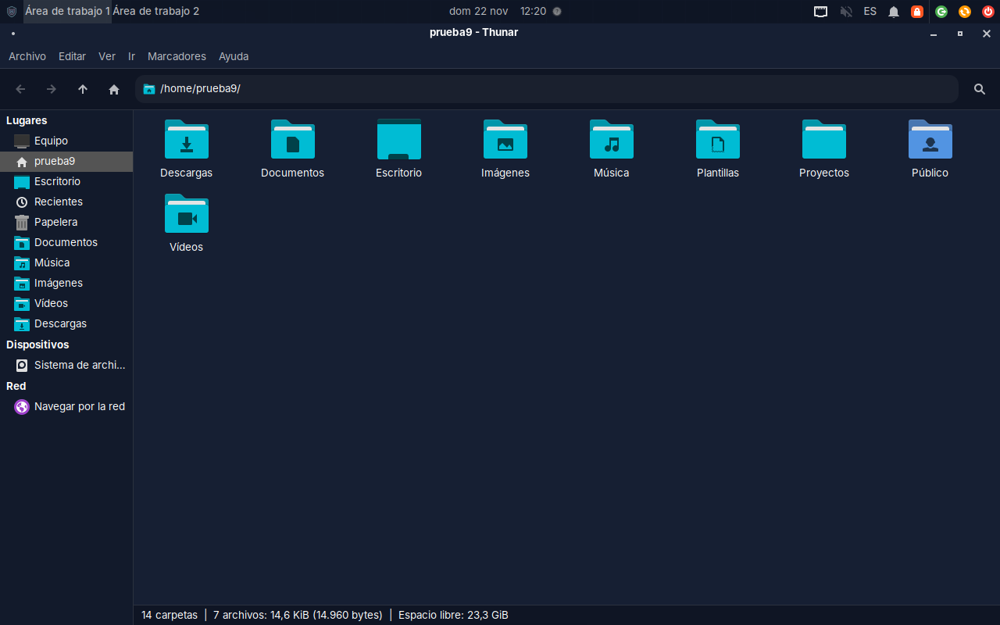
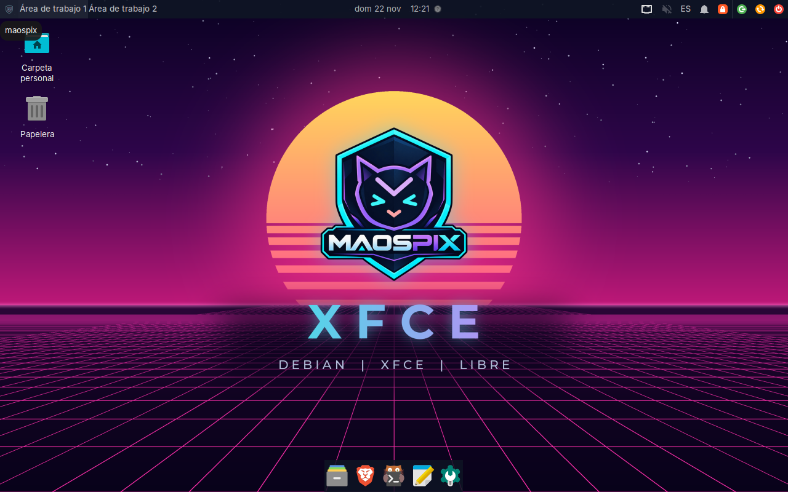
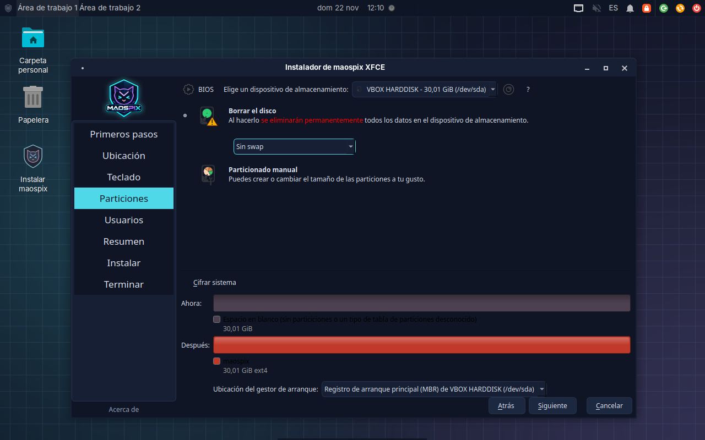

# maospix-xfce

Distro **Debian 14 "Forky" (testing) + XFCE 4.20**, moderna en aspecto pero liviana, pensada también para
**hardware viejo** (ej. Intel i3 de 2ª generación, 4 GB de RAM, BIOS legacy). Todo viene preinstalado y
tematizado, lista para usar. Parte de la familia **maospix**.



## Descarga

| Versión | ISO | Tamaño |
|---|---|---|
| **1.0** | [maospix-xfce-1.0-amd64.iso](https://sourceforge.net/projects/maospix-xfce/files/1.0/) (SourceForge) | 2,0 GB |

SHA-256:

```
8d9ae68ba44fcc99573e5fc3b6cf16e551cff7e5ddb1692d42371d4ac6ded271  maospix-xfce-1.0-amd64.iso
```

Comprobar en Linux: `sha256sum maospix-xfce-1.0-amd64.iso` · en Windows (PowerShell): `Get-FileHash maospix-xfce-1.0-amd64.iso`

Se puede grabar con **Ventoy**, `dd`, balenaEtcher o Rufus (modo DD). Arranca en **UEFI y BIOS legacy**.

## Qué trae

- **Escritorio:** XFCE 4.20 con panel superior + dock inferior (docklike), menú Whisker, reloj y clima,
  tema oscuro Maospix-Dark, íconos Papirus-Dark con carpetas cian, cursor Bibata, 6 fondos maospix.
- **Terminal:** kitty con shell **fish** y **fastfetch** con el logo maospix.
- **Apps:** Brave, Thunar, Mousepad, Ristretto, mpv, file-roller, GNOME Discos, btop, htop.
- **Sonido y red:** PipeWire + WirePlumber, NetworkManager, Bluetooth (blueman).
- **Instalador:** Calamares con branding maospix: ext4, btrfs (subvolúmenes + zstd) o xfs, swap en archivo,
  contraseñas cortas permitidas, inicio de sesión automático opcional.
- **Idioma:** Español (Paraguay) por defecto: `es_PY.UTF-8`, teclado `latam`, hora `America/Asuncion`.
- **Firmware** `non-free-firmware` para WiFi y GPU en PCs reales. Sin drivers propietarios de NVIDIA.

### Atajos de teclado

| Atajo | Acción |
|---|---|
| Tecla Windows / Alt+F1 | Menú de aplicaciones |
| Super+Enter | Terminal |
| Super+Q | Cerrar ventana |
| Super+← / → | Ventana a media pantalla |
| Super+↑ / ↓ | Maximizar / minimizar |
| Super+E | Thunar |

## Capturas

| | |
|---|---|
|  |  |
|  |  |

## Requisitos

- CPU x86-64 (64 bits), 2 GB de RAM (4 GB recomendado), 20 GB de disco.
- Usuario del live: `liveuser` (sin contraseña). Para instalar: ícono **"Instalar maospix"** del escritorio.

## Construir la ISO

Hace falta un Debian Forky (o testing) con `live-build`, `debootstrap` y `xorriso`:

```
sudo apt install live-build debootstrap xorriso
git clone https://github.com/maospy/Maospix-XFCE.git maospix-xfce
cd maospix-xfce
sudo bash tools/build-iso.sh       # deja la ISO en out/pruebaN/
bash tools/verificar-iso.sh out/pruebaN/*.iso   # revisa el contenido antes de probarla
```

## Estructura

| Carpeta | Contenido |
|---|---|
| `config/` | Perfil de live-build (paquetes, hooks, Calamares, arranque) |
| `packages/maospix-xfce-settings/` | Paquete `.deb` con todo el tema y la configuración (`/etc/skel`, `/usr/share/maospix`) |
| `tools/` | `build-iso.sh`, `verificar-iso.sh` y otros scripts |
| `assets/` | Logo, wallpapers y generadores de imágenes del branding |
| `docs/` | Capturas y notas de progreso |

## Familia maospix

- [Maospix-KDE](https://github.com/maospy/Maospix-KDE): Arch + KDE Plasma.

## Licencia

[GPL-3.0](LICENSE). Brave y el firmware de Debian mantienen sus propias licencias.
